# 안저 사진 뷰어 (Fundus Viewer)

Windows 10 / 11용 안저카메라 전용 뷰어입니다. **감시 폴더에 사진 파일이 떨어지면** 파일에서
환자 ID·이름 등 환자 정보를 추출해 뷰어 데이터베이스로 가져오고, 2D로 보거나 **광각 사진을
실제 안구처럼 입체(3D) 모델**로 돌려 볼 수 있습니다.

우선 회사 초광각 모델 **SYSEYE RetiCam 3100 Plus (1회 176° · 몽타주 220°)** 에 맞춰
만들었고, **Microclear APOLLO (WA 135° / UWA 165°)**, **Kowa VK-2 / VK-2s** (nonmyd·VX
시리즈) 출력과 일반 안저카메라 파일도 읽습니다.

| 2D 보기 | 3D 안구 — 간단히 |
|---|---|
| 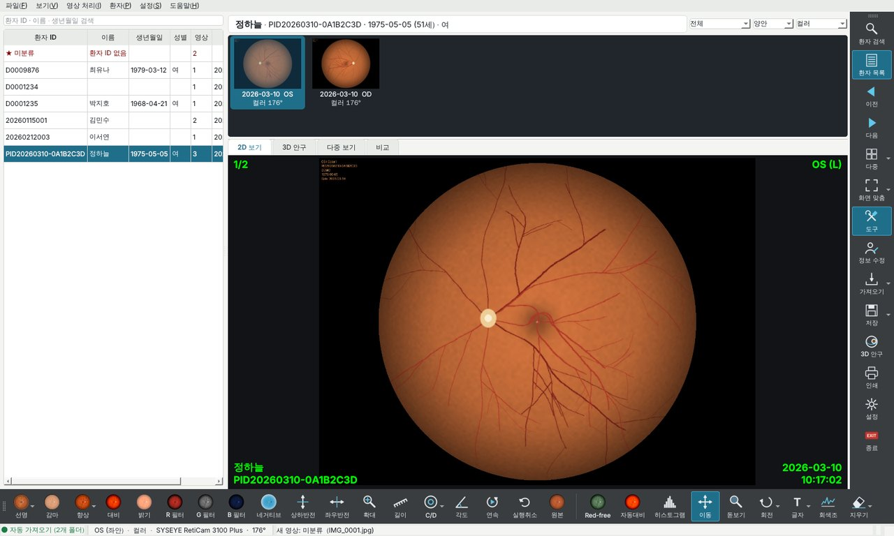 | 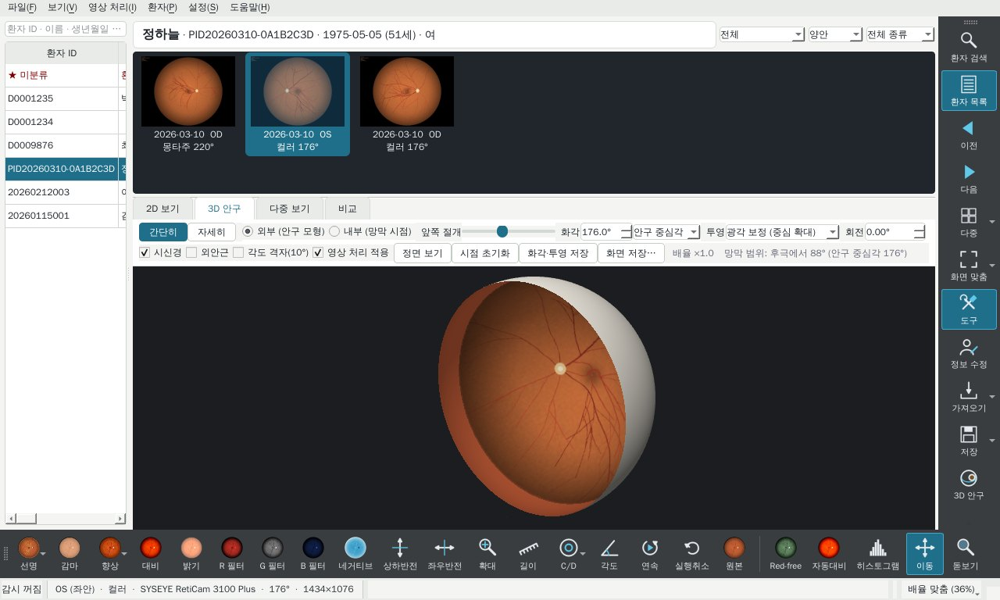 |
| **3D 안구 — 자세히 (절개 보기)** | **3D 안구 — 자세히 (닫힌 안구)** |
| 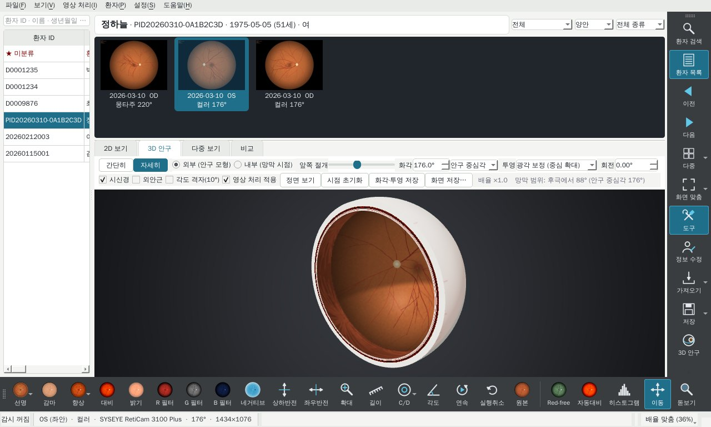 | 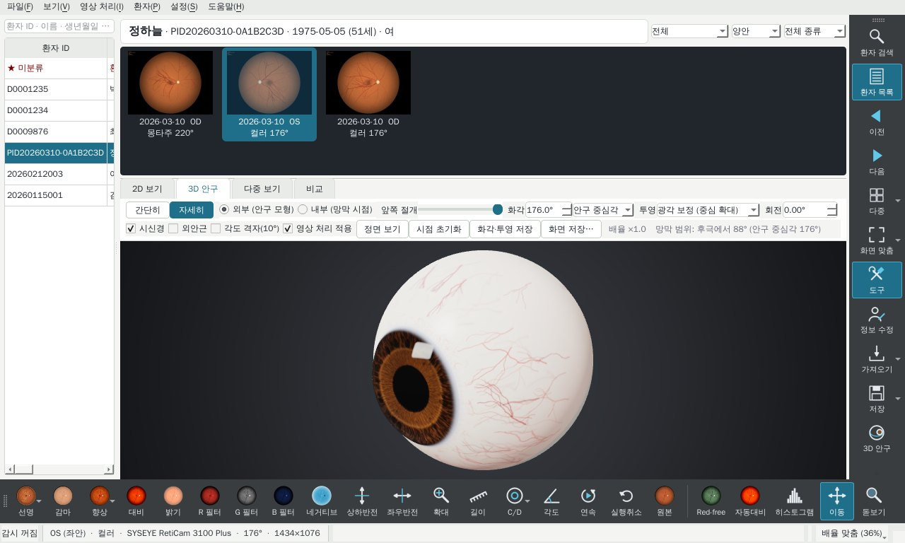 |
| **3D 안구 — 내부(망막 시점)** | **2D — 후극부 확대와 미니맵** |
| 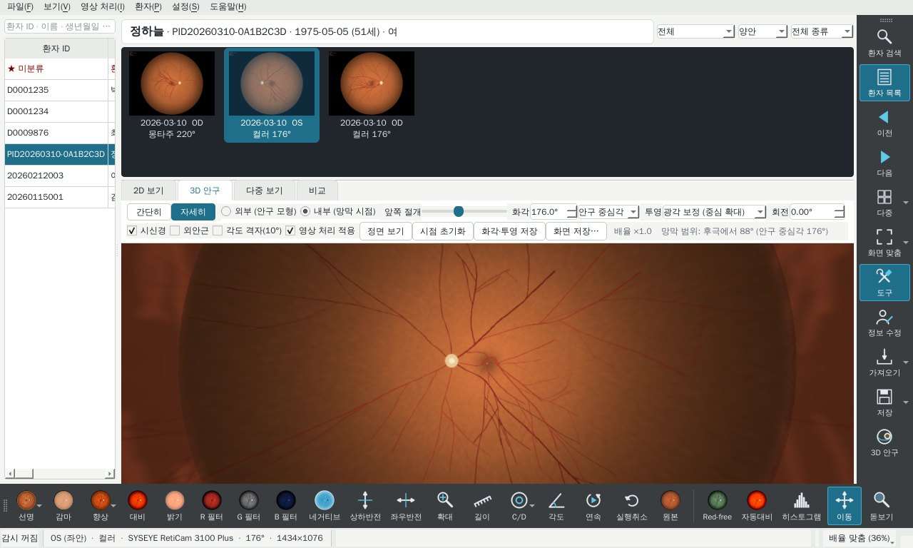 | 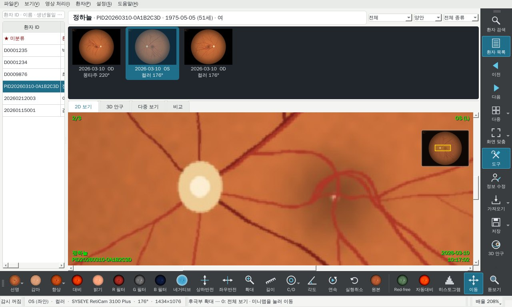 |

**자세히** 보기는 실제 해부 구조대로 그립니다.

| 각막·홍채 (굴절·반사광) | 앞쪽 절개 70 — 섬모체 돌기·소대·수정체 |
|---|---|
| 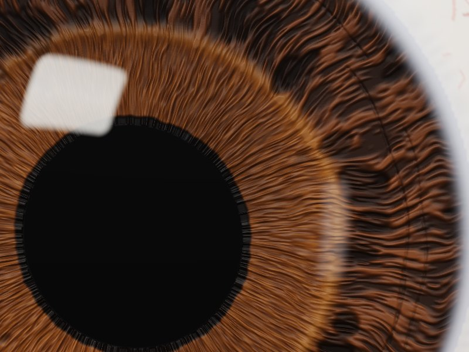 | 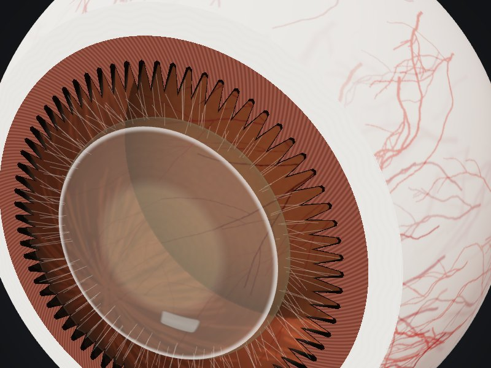 |
| **안구벽 단면 — 공막·맥락막·RPE·망막층** | **외안근 부착부와 시신경** |
| 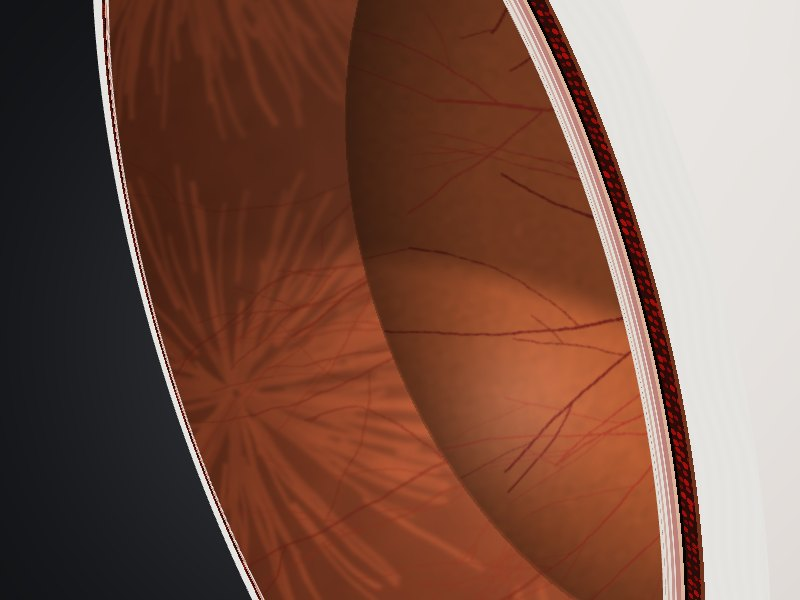 | 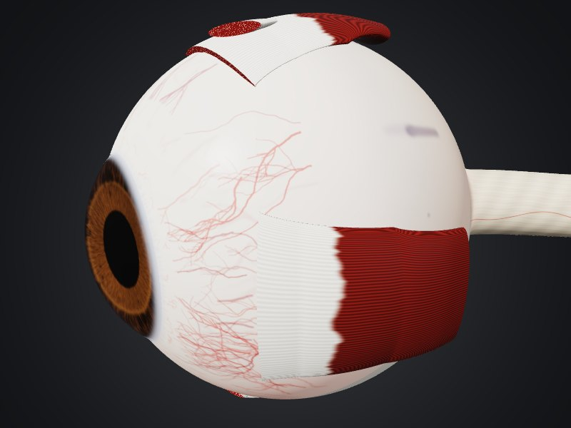 |

> 화면의 사진과 환자는 모두 `fundusview/demo.py`가 만든 **합성(가상) 데이터**입니다.

## 빠른 시작

```bat
pip install -r requirements.txt
python run_viewer.py --demo
```

`--demo`는 빈 라이브러리에 가상 환자 사진(RetiCam·APOLLO·VK-2·DICOM 형식)을 넣어 바로 써 볼
수 있게 합니다. `--home D:\FundusViewer`를 주면 설정과 라이브러리를 그 폴더 하나에 둡니다(휴대용).

**내려받기 (Windows 10 / 11):**
https://github.com/kukje1980/ophthal-electrophysiology/releases/download/fundus-viewer-latest/FundusViewer-windows.zip
— 로그인 없이 받아지며 항상 최신 빌드입니다. 압축을 풀고 `FundusViewer\FundusViewer.exe`를 실행합니다
("Windows의 PC 보호" 창이 뜨면 **추가 정보 → 실행**).

**직접 빌드:** `build_windows.bat` 실행 → `dist\FundusViewer\FundusViewer.exe` (폴더째 복사해 사용).
GitHub Actions(`fundus-viewer` 워크플로)가 커밋마다 Windows exe를 빌드해 위 주소(릴리스
`fundus-viewer-latest`)에 올립니다.

## 사용 흐름

사진 가져오기는 **설정 없이 자동**입니다. 프로그램을 켜면:

* **가져오기 폴더** `문서\안저사진 가져오기`를 만들고 감시합니다. 여기에 넣은 사진은 라이브러리로
  **옮겨지므로** 폴더가 비면 모두 들어간 것입니다.
* 모든 드라이브(네트워크 드라이브 포함)에서 촬영 프로그램 폴더를 찾아 알맞은 카메라 프로필로
  감시 목록에 넣습니다. 장비 폴더는 **복사**만 하고(원본 유지), 네트워크 드라이브는 폴링합니다.

  | 장비 | 찾는 폴더 |
  |---|---|
  | SYSEYE RetiCam 3100 Plus | `X:\reticam`, `X:\RetiCam`, `X:\레티캠`, `X:\SYSEYE` |
  | Microclear APOLLO | `X:\MicroClearClient\ImageData`, `X:\MC\Cro\PatientCapture`, `%USERPROFILE%\MicroClearClient\ImageData` |

* 감시가 바로 시작됩니다. 새 파일은 쓰기가 끝날 때까지 기다린 뒤 가져오고, 프로그램이 꺼져 있던
  동안 들어온 파일도 시작할 때 찾아냅니다.

다른 위치(예: 장비 PC의 공유 폴더 `\\<장비 IP>\D\reticam`)는 **설정 → 감시 폴더 → 폴더 추가**로
넣습니다. 설정에서 지운 폴더는 다시 자동으로 추가되지 않으며, **설정 → 일반**에서 자동 찾기를 끄거나
**지금 장비 폴더 다시 찾기**를 누를 수 있습니다.

1. 새 사진이 들어오면 그 환자와 사진이 바로 열립니다(파일 → 새 영상 자동 표시).
2. 왼쪽 환자 목록 → 썸네일 → **2D 보기 / 3D 안구 / 다중 보기 / 비교** 탭.
3. 환자 ID를 찾지 못한 사진은 **★ 미분류**로 들어갑니다. 사진을 고르고 오른쪽 **정보 수정** 버튼으로
   환자를 지정합니다. 잘못된 환자로 잘못 들어가는 것보다 미분류가 안전하므로 추측하지 않습니다.

창에 파일·폴더를 끌어다 놓아도 가져오며, 같은 내용의 파일(SHA-256)은 한 번만 들어갑니다.

## 화면 구성 (Kowa VK-2 방식)

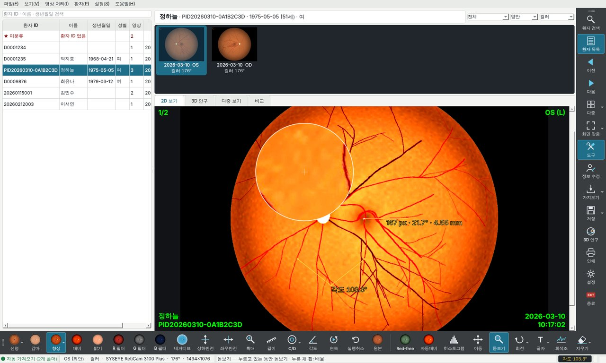

VK-2 캡처 화면처럼 만들었습니다.

* 검은 영상 화면과 **오른쪽 명령 툴바**, **아래쪽 영상 처리 툴바**로 되어 있습니다.
* 사진 위에는 VK-2처럼 **녹색 글자**가 나옵니다. 왼쪽 위에 사진 번호(`1/2`), 오른쪽 위에 눈(`OD (R)`),
  왼쪽 아래에 이름·ID, 오른쪽 아래에 촬영 날짜·시각입니다. 보기 → 화면 글자 표시로 끕니다.
* 상태 표시줄에는 자동 가져오기 상태, 영상 정보(눈 · 촬영 종류 · 장비 · 화각 · 크기), 측정 결과가 나옵니다.
  영상 정보에 마우스를 올리면 값마다 **어디서 읽었는지**(RetiCam 데이터 / 파일 이름 / DICOM …)가 보입니다.
* 두 툴바는 끌어서 옮길 수 있고, 보기 → 툴바 기본 위치로 되돌립니다. ▾ 표시가 있는 버튼은 화살표를
  누르면 추가 기능이 나옵니다. 버튼 위에 마우스를 올리면 VK-2의 해당 버튼 이름도 보입니다.

**오른쪽 명령 툴바** (VK-2 Command Toolbar 순서)

| 버튼 | VK-2 | 기능 |
|---|---|---|
| 환자 검색 | ID# SEARCH | 환자 ID·이름 검색 (Ctrl+F) |
| 환자 목록 | OPEN LIST | 왼쪽 환자 목록 보이기/숨기기 |
| 이전 / 다음 | PREV / NEXT | 이전·다음 사진 (PageUp / PageDown) |
| 다중 ▾ | MULTI | 다중 보기 (1·2·4·6·9·16장) |
| 화면 맞춤 ▾ | SCALE | 화면 맞춤 · 100~800% · **확대 위치**: 후극부, 위·아래·코·귀쪽 주변부 |
| 도구 | TOOLS | 영상 처리 툴바 보이기/숨기기 |
| 정보 수정 | EDIT DATA | 사진의 환자 지정, 검사 정보 수정 |
| 가져오기 ▾ | CAPTURE | 파일 · 폴더 가져오기, 감시 폴더 지금 검사 |
| 저장 ▾ | SAVE | 편집 영상을 환자 기록에 새 사진으로 저장(원본은 그대로) · 파일로 저장 · 클립보드 복사 |
| 3D 안구 | (DDV 자리) | 3D 안구 모형 |
| 인쇄 | PRINT | 화면 영상 + 환자 정보 머리말 (Ctrl+P) |
| 설정 · 종료 | EXIT | |

**아래쪽 영상 처리 툴바** (VK-2 Image Processing Toolbar 순서)

버튼 그림은 VK-2처럼 **작은 안저 사진에 그 효과를 적용한 모습**입니다. 사진에 적용 중인 처리는
버튼이 켜진 색으로 표시되고, 툴바에 마우스를 올리면 적용 순서가 보입니다.

| 버튼 | VK-2 | 기능 |
|---|---|---|
| 선명 ▾ | SHARPEN | 선명하게 (누를 때마다 누적, ▾ 약·강) |
| 감마 · 대비 · 밝기 | GAMMA · CONTST · BRIGHT | 버튼 옆에 슬라이더가 열림, 초기화 버튼 |
| 향상 ▾ | ENHANCE | 국소 대비 향상(미세 혈관·병변), ▾ 히스토그램 평활화 · 노이즈 감소 |
| R · G · B 필터 | RED · GREEN · BLUE FILTER | 한 색 성분만. 켜진 필터를 다시 누르면 컬러 |
| 네거티브 | NEGATIVE | 반전 영상 |
| 상하반전 · 좌우반전 | FLIP VRT · FLIP HRZ | |
| 확대 | ZOOM | 위로 드래그 확대, 아래로 축소, 클릭 2배, Shift+클릭 ½ |
| 길이 | LENGTH | px와 **망막 각도·mm** |
| C/D ▾ | C/D RATIO | 길이 방식(cup·disc 지름) / ▾ 면적 방식(최대 12점 둘레) |
| 각도 | ANGLE | 세 점(가운데 점이 꼭짓점) |
| 연속 | LOOP | 이 환자 사진을 차례로 보기 (사진 클릭 시 멈춤) |
| 실행취소 · 원본 | UNDO · ORIGINAL | 마지막 처리 되돌리기 (Ctrl+Z) · 모든 처리·측정 해제 |
| Red-free · 자동대비 · 히스토그램 | | 녹색 채널 · 밝기 범위 자동 맞춤 · 검정/흰색 레벨 |
| 이동 · 돋보기 · 회전 ▾ | | 드래그 이동 · 누르는 동안 돋보기(누른 채 휠로 배율) · 90° 회전 |
| 글자 ▾ · 회색조 · 지우기 ▾ | | 글자 / 화살표+글자 · 누르는 동안 그 가로줄 밝기 그래프 · 마지막 / 모든 측정 지우기 |

**마우스 조작 (모든 도구 공통)**
* **휠**: 커서 위치를 중심으로 확대·축소
* **오른쪽 버튼 드래그**: 위로 끌면 확대, 아래로 끌면 축소. 드래그 없이 클릭하면 메뉴가 열립니다.
* **가운데 버튼 드래그**: 이동 · **더블클릭**: 화면에 맞춤
* **키보드**: `+` / `−` 확대·축소(커서 위치) · `0` 화면에 맞춤 · `1` 100%

**확대해서 보기 (광각 사진)**

* 원본 해상도 그대로 최대 40배까지 확대합니다.
* **미니맵**: 확대하면 오른쪽 위에 전체 사진이 나오고 지금 보는 곳이 노란 틀로 표시됩니다.
  미니맵을 누르거나 끌면 그곳으로 이동합니다(오른쪽 클릭 메뉴에서 끌 수 있음).
* **확대 위치**: 화면 맞춤 ▾ 또는 상태 표시줄 오른쪽의 **[배율]** 버튼에서 후극부(황반·시신경)와
  위·아래·코·귀쪽 주변부로 바로 확대합니다. 코쪽은 시신경 유두 쪽(OD 오른쪽, OS 왼쪽)이고,
  촬영 원이 화면 틀보다 큰 광각 사진에서도 사진 안으로 맞춥니다.
* **[배율]** 버튼에 현재 배율이 표시됩니다(예: `배율 208%`, 맞춤일 때 `배율 맞춤 (36%)`).
* 돋보기 도구는 누르는 동안 커서 아래만 2~10배로 보여 줍니다.

**처리와 측정 동작 방식**
* 처리는 화면에서만 적용되며 저장된 원본 사진은 바뀌지 않습니다.
* 다른 사진으로 넘어가면 선명·향상 같은 처리 단계는 초기화됩니다. 감마·대비·밝기·필터는 유지됩니다.
* 길이는 그 영상의 화각·투영(3D와 같은 안구 모형)으로 **망막 위 실제 거리**로 바꿔 보여 줍니다. 초광각 사진은 주변부일수록 화소당 거리가 달라서 화소 길이만으로는 비교할 수 없기 때문입니다.
* 마우스 위치의 좌표, RGB 값, 후극에서의 각도는 상태 표시줄 오른쪽에 나옵니다.

**다중 보기** 탭은 VK-2 Multiple Images 기능입니다.
* 한 화면에 1·2·4·6·9·16장을 띄웁니다.
* 클릭하면 그 사진이 선택되고, 더블클릭하면 2D로 엽니다.
* 칸마다 따로 확대할 수 있습니다.

| 다중 보기 (4장) | Red-free (VK-2 사진) |
|---|---|
| 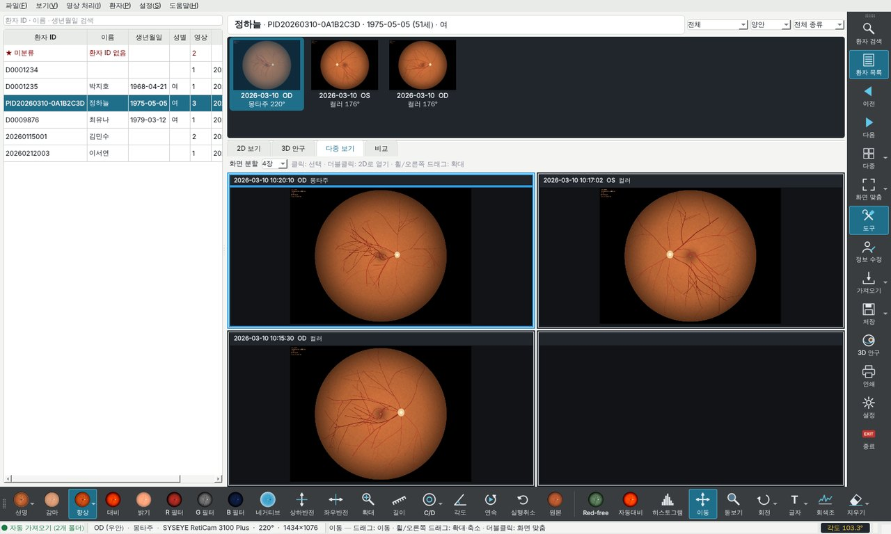 | 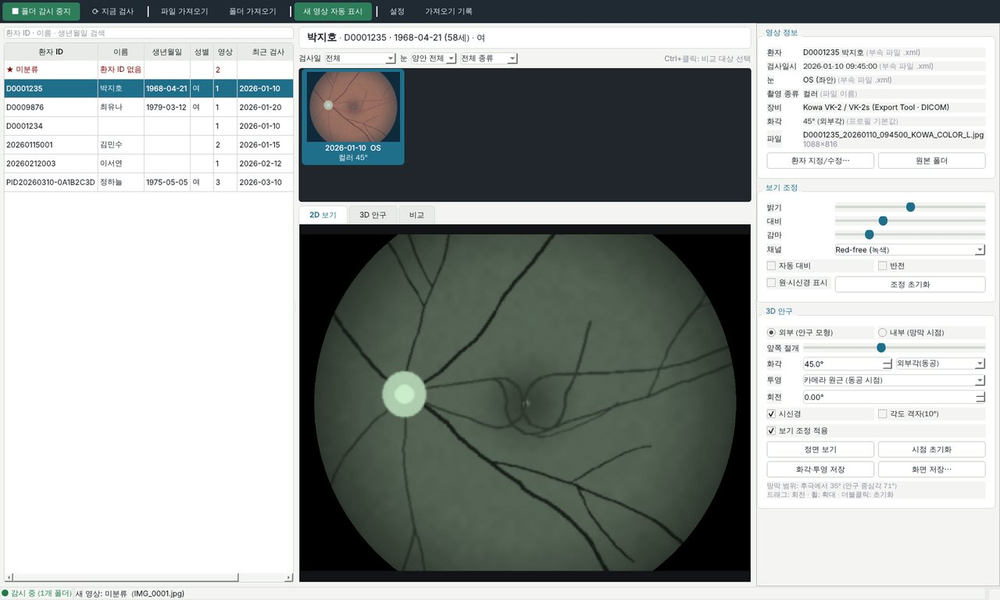 |

## 장비별 폴더와 읽는 정보

| 장비 | 감시할 폴더 | 읽는 정보 |
|---|---|---|
| **SYSEYE RetiCam 3100 Plus** | 장비 PC의 저장 폴더, 예: `D:\reticam`(장비 PC에 설치) 또는 네트워크 공유 `\\<장비 IP>\D\reticam`(**폴링** 체크) | JPEG 안 APP15 JSON(`patientID`, `patientName`/`patientLastName`+`patientFirstName`, `patientBornDate`, `patientSex`, `eyeLaterality`, `modeID`, 몽타주 여부), 파일 이름 `<이름>-od-color-YYYYMMDD-HHMMSS-mmm` |
| **Microclear APOLLO** | 장비 공유 폴더 `…\PatientCapture` (SMB, **폴링** 체크) 또는 PC 뷰어 `MicroClearClient\ImageData` | 폴더 `<ID>_<이름>`, JPEG 주석 `Description:{JSON}`(검사 시각·Eye·FieldAngle·DevModel·ImgType), 케이스 내보내기 `<ID>.json`(생년월일·성별) |
| **Kowa VK-2 / VK-2s** | Kowa Export Tool 출력 폴더, VK-2 DICOM 로컬 저장 폴더 | 파일명 `ID_YYYYMMDD_HHMMSS_R_FUNDUS (COLOR)_1` (VK EXPORT / MDR / JOIA 형식), JOIA `.xml`, DICOM 태그 |
| VK-2 "폴더로 복사" | 그 폴더 (프로필: *파일명 = 환자 ID*) | 파일 이름 = 환자 ID |
| 기타 카메라 | 저장 폴더 | DICOM, EXIF/XMP/JPEG 주석, 같은 이름의 `.txt/.ini/.xml/.json/.csv`, 일반 파일명 규칙 |

**RetiCam 참고**
* 장비의 기본 환자(`#AnonymousID#` / Anonymous / 1980-01-01)로 찍은 사진은 등록되지 않은
  환자이므로 **미분류**로 들어옵니다.
* 촬영 시각은 파일 이름의 시각을 씁니다. JSON의 `dateTime`은 시간대만큼 몇 시간 어긋난 경우가
  있습니다.
* 확장자가 `.jpg`인데 내용이 TIFF인 내보내기 파일도 읽습니다(TIFF 태그에서 JSON을 찾음).
* VK-2와 연동해 "파일 이름 앞 6자리 = 환자 ID"로 내보내도록 설정한 병원은 **설정 → 파일명
  규칙**에 `^(?P<pid>\d{6})`을 추가하세요.
* 사진 왼쪽 위에 이름·ID가 글자로 찍혀 있습니다(장비가 넣는 것). 3D에서는 촬영 원 밖이라
  보이지 않습니다.

VK-2 원본 저장소(`vk_3x\-000512\vk000005.jpg`)의 파일은 이름에 환자 정보가 없어
(환자 연결은 `vk3x.mde` DB에만 있음) **미분류**로 들어옵니다. VK-2 사진은 Export Tool 또는
DICOM 내보내기 폴더를 감시하세요.

### 환자 정보 추출 순서

앞선 출처가 채운 값은 뒤에서 바꾸지 않습니다. 각 값의 출처는 상태 표시줄의 영상 정보에 마우스를 올리면 보입니다.

1. **DICOM 태그**: PatientID, PatientName(한글 이름 그룹 우선; `Specific Character Set`이 없는
   VK-2 파일은 CP949 / ISO 2022 이스케이프를 직접 해석), BirthDate, Sex, Acquisition/Content
   Date·Time, Image Laterality(0020,0062)→Laterality(0020,0060), Horizontal FOV(0022,000C)
2. **장비 데이터**: RetiCam APP15 JSON, APOLLO 폴더·JSON (`Eye` 1=OD 0=OS, `FieldAngle`
   60/90/112 → 90/135/165°)
3. **부속 파일**(sidecar): JOIA XML의 `ID / LastName / FirstName / DOB / Sex / ImageLaterality` 등
4. **이미지 내장 텍스트**: EXIF(Make/Model, DateTimeOriginal, UserComment, Windows XP 태그),
   JPEG 주석, PNG 텍스트, XMP에서 `PatientID=…; Name: …` 형태의 키·값
5. **파일·폴더 이름**: 프로필 규칙 → 사용자 규칙(설정 → 파일명 규칙, 정규식, 즉석 시험 가능)
   → 일반 규칙(`ID_이름_YYYYMMDD_OD`, `12345678_홍길동` …) → 상위 폴더(`12345_홍길동\20240305\`)
6. 그래도 없으면: 화각은 프로필 기본값, 검사일은 파일 시각, 눈은 시신경 유두 위치로 추정
   (OD는 유두가 오른쪽)

이미 등록된 환자의 이름·생년월일은 가져오기로 덮어쓰지 않습니다(빈 칸만 채움).

## 3D 안구 모델

반지름 1(≈12 mm)인 구를 안구로 봅니다. 사진은 메시에 붙이지 않고 프래그먼트 셰이더가
망막 표면의 점마다 **안구 중심에서 잰 후극으로부터의 각도 θ**와 방위각 φ를 구해 사진에서 색을
찾습니다. 그래서 화각·투영·회전을 바꾸면 바로 반영되고 확대해도 정확합니다.

* **화각 기준**: 광각 장비는 안구 중심각(내부각)으로, 일반 안저카메라(45°/50°)는 동공에서 잰
  외부각으로 표시합니다. 변환은 동공(절점) 위치 `d = 0.58`(안구 반지름 단위)인 원근 모델로 하며,
  이 값은 "내부 200° ≈ 외부 135°" 관례와 맞습니다. Microclear 규칙(외부각 × 1.5 = 안구 중심각)과도
  일치합니다.
* **투영**: 카메라마다 다음을 기본으로 씁니다. 스테레오그래픽과 정사영도 고를 수 있습니다.
  * **RetiCam 3100 Plus**: **광각 보정(중심 확대)**. 식은 `θ = θmax·((1−c)·ρ + c·ρ³)`,
    `c = 0.2545`, `θmax = 88°`입니다. 같은 176°라도 등거리로 펴면 실제 사진에서 시신경 유두
    (중심에서 영상 반경의 0.32)가 중심와에서 28°에 놓여, 해부학적 위치(약 22°)와 맞지 않습니다.
    이 식은 유두가 22°에 오도록 중심부를 확대합니다. 몽타주는 220°로 둡니다. 2023년형 50°급
    RetiCam 파일은 일반 카메라 원근으로 처리합니다.
  * **APOLLO**(SLO 스캔): 스캔각이 영상 반경에 비례하므로 **등거리(각도 비례)**를 씁니다.
  * **일반 카메라**: **카메라 원근(동공 시점)**, 즉 `tan α = sin θ / (cos θ + d)`를 씁니다.
  검증: 공급사 UWA 샘플에서 유두가 중심에서 약 250 px(반경 1023 px) 떨어져 있고, 등거리 165°로
  바꾸면 약 20°입니다. 이는 해부학적 중심와–유두 거리(약 4.5 mm / 12 mm)와 일치합니다.
* **보기 방식**: 3D 막대 맨 앞의 **[간단히] / [자세히]**.
  * **간단히**(기본): 예전의 가벼운 모형입니다. 흰 공막과 단순한 홍채·각막·시신경 위에 사진을 보여 주며,
    어느 PC에서나(소프트웨어 렌더링 포함) 빠릅니다.
  * **자세히**: 아래 [해부학적 묘사](#해부학적-묘사)의 실제 해부 구조 모형입니다.
  고른 방식은 저장되어 다음 실행에도 유지됩니다.
* 3D 탭 위쪽 막대에서 외부/내부, 앞쪽 절개, 화각, 투영, 회전, 시신경·외안근(자세히)·각도 격자를 바꿉니다.
* **3D 확대**: 휠을 돌리면 **커서가 가리키는 곳으로** 다가갑니다(절개한 안구 안의 망막도 그 점이 커서 아래에
  그대로 남음). 오른쪽 드래그도 확대, 가운데 버튼 또는 Shift+드래그로 이동, `+`/`−`, 더블클릭·`0`은 처음
  보기입니다. 내부 모드에서는 커서 쪽으로 시선을 돌리며 시야를 4°까지 좁힙니다. 배율은 막대에 `배율 ×2.2`처럼
  표시됩니다.
* **외부 모드**: 공막·각막·홍채와 시신경을 그립니다. 시신경은 검출된(또는 2D 화면에서 우클릭으로
  지정한) 유두 뒤에 붙습니다. "앞쪽 절개" 슬라이더로 앞부분을 잘라 안쪽 망막을 봅니다.
  오른쪽 끝(100)으로 밀면 닫힌 안구가 됩니다.
* **내부 모드**: 안구 안에서 망막을 바라봅니다. 드래그로 시선 이동, 휠로 시야를 넓히거나 좁힙니다.
* **각도 격자**: 후극에서 10°마다 링을 그립니다(30°마다 진하게).
* 사진 밖의 망막은 맥락막 무늬·주변부 혈관·톱니둘레까지 이어 그립니다. 45° 사진은 망막의 작은
  부분만, UWA 165° 사진은 대부분을 덮는 것이 정상입니다.
* "화각·투영 저장"을 누르면 그 영상의 매핑 값을 DB에 저장합니다.

### 해부학적 묘사

치수는 성인 평균(`fundusview/ui/eye_model.py`, 1 = 12 mm)이고, 질감은 처음 실행할 때 한 번 만들어
설정 폴더의 `cache\`에 저장합니다(다음부터는 바로 열림).

* **공막**: 젖은 표면의 광택, 결막 혈관(검열 부위에 많음)과 윤부 혈관 고리, 곧은근 부착부에서
  나오는 앞섬모체동맥, 깊은 공막위 혈관, 적도 뒤의 소용돌이정맥 4개, 시신경 둘레의 짧은뒤섬모체동맥.
* **각막**: 화소마다 광선을 추적합니다. 앞면 반사(프레넬)로 조명 상자가 비치는 반사광, 굴절(n 1.336)로
  보는 각도에 따라 확대·이동해 보이는 홍채, 동공 안 수정체 앞면의 희미한 반사(푸르키녜 Ⅲ상),
  공막이 덮이는 윤부 경계.
* **홍채**(갈색): 방사상 섬유주, 동공 주름(ruff), 지그재그 홍채주름(collarette), 푹스 움(crypt),
  수축 고랑, 주근깨. 높낮이를 음영으로 표현합니다.
* **안구벽 두께**: 절개면에 공막 → 맥락막상강 → 맥락막(혈관 단면) → RPE → 망막층(시세포·핵층·망상층·
  신경섬유층)이 보이고, 톱니둘레 앞에서는 섬모체 단면이 됩니다.
* **안쪽**: 톱니 모양 톱니둘레(ora serrata), 섬모체 평면부, 섬모체 돌기 72개, 섬모소대, 수정체
  (단면에서 노란 핵·피질층·피막), 홍채 뒷면, 전방각(섬모체띠·공막돌기·섬유주·슈발베선).
  절개 가장자리가 안쪽 벽에 그림자를 드리웁니다. 절개 슬라이더 70 전후가 섬모체·수정체,
  81~83이 홍채 단면, 88 이상이 각막만 뗀 상태입니다.
* **시신경**: 경막 싸개가 공막과 이어지고, 잘린 끝에 신경 다발·경막·거미막밑공간과 중심망막동맥·정맥이
  보입니다.
* **외안근**(선택): 네 곧은근(틸로 나선 거리대로 부착, 흰 힘줄 → 붉은 근육)과 두 빗근의 절단 부위.

3D는 OpenGL 2.1이 필요합니다. 그래픽 드라이버가 오래된 PC에서는 **설정 → 일반 → 3D 렌더링 →
소프트웨어 렌더링**을 고르고 다시 시작합니다(PySide6에 포함된 Mesa `opengl32sw.dll` 사용).

## 구조

```
fundusview/
  app.py            진입점 (OpenGL 모드, 스타일, --demo / --home)
  config.py         설정 JSON (%APPDATA%\FundusViewer\settings.json)
  db.py             SQLite: patients / images / seen_files / import_log
  profiles.py       카메라 프로필 (RetiCam, APOLLO, VK-2, VK-2 ID 폴더, 일반)
  extract/          메타데이터 추출 (dicom / reticam / apollo / embedded+sidecar / filename / normalize)
  importer.py       안정화 대기 → 중복 검사 → 추출 → 분석 → 라이브러리 저장 → DB
  watcher.py        watchdog 감시(또는 폴링) + 재검사 + 가져오기 작업 스레드
  imaging.py        영상 읽기(DICOM 포함), 촬영 원·시신경 검출, 표시 조정(LUT)
  projection.py     안구 기하 (θ↔영상 반경, 내부각↔외부각) — 셰이더와 동일한 식
  demo.py           합성 안저 사진 + 장비별 형식 데모 폴더
  measure.py        측정 (화소 → 망막 각도·mm, 각도, 면적)
  autosetup.py      자동 가져오기: 가져오기 폴더 + 장비 폴더(RetiCam·APOLLO) 찾기
  ui/               main_window, toolbars(VK-2 명령·영상 처리 툴바), icons, eye3d(OpenGL 셰이더),
                    eye_model(안구 해부 치수·메시·절차적 질감), image_view(도구·녹색 글자),
                    multi_view, histogram, dialogs, style.qss
tests/              pytest (추출·투영·영상·가져오기·감시·GUI·3D 안구 모델·OpenGL 렌더링)
```

라이브러리 폴더(기본: `문서\FundusViewerLibrary`)에는 `fundus.db`, `images\<환자ID>\<검사일>\`
사본, `thumbs\`, `display\`(DICOM을 PNG로 바꾼 사본)가 들어갑니다. 처리 방식은 폴더마다
**복사**(기본, 원본 유지) / 이동 / 원본 위치 참조 중에서 고릅니다. 장비 공유 폴더는 반드시 복사나
참조로 두세요.

## 테스트

```bash
QT_QPA_PLATFORM=offscreen python -m pytest -q tests
```

`offscreen`에는 OpenGL이 없어서 3D 렌더링 테스트(`tests/test_eye3d_gl.py`)는 건너뜁니다. 리눅스에서는
Xvfb와 Mesa로 셰이더 컴파일까지 확인할 수 있습니다(CI도 이렇게 돌립니다).

```bash
FUNDUSVIEW_REQUIRE_GL=1 QT_QPA_PLATFORM=xcb xvfb-run -a python -m pytest -q tests/test_eye3d_gl.py
```

## 알려진 한계와 다음 단계

* **RetiCam 투영 보정은 잠정값**입니다. 근거는 몽타주 샘플 한 장의 측정과 해부학적 유두 위치뿐입니다.
  보정을 확정하려면 둘 중 하나가 필요합니다.
  * SYSEYE에서 투영·왜곡 자료나 DICOM 적합성 문서를 받기
  * 격자 시험판을 찍은 사진으로 맞추기
  그때까지 3D 화면에서 투영을 "등거리"로 바꿔 비교할 수 있고, 영상별 "화각·투영 저장"도 됩니다.
  주변부 고정 촬영(fixation) 사진의 회전 정보는 아직 쓰지 않습니다.
* **VK-2 원본 DB 연동**: `vk3x.mde`(Access) 스키마가 문서화되어 있지 않아, 원본 저장소
  사진의 환자 연결은 아직 하지 않습니다. 샘플 `.mde`로 테이블 구조를 확인한 뒤 읽기 전용
  커넥터를 추가할 수 있습니다. VK-2 전용 무손실 형식 `.dlt`는 읽지 못합니다.
* **APOLLO 단일 모드 파일**(IR / RF / FFA / AF / ICGA+FFA)의 JSON에는 환자 경로가 없습니다. 이런
  파일은 `PatientCapture\<ID>_<이름>` 폴더 구조에서 환자를 찾습니다. ICGA 단독의 `ImgType` 값은 아직
  확인하지 못했습니다. PNG 내보내기의 바이너리 헤더는 SKY 샘플 하나로만 확인했습니다.
* 3D 매핑은 1차 광학 모델입니다(카메라 왜곡과 안축장 차이는 반영하지 않음). 측정·진단용이 아닌
  시각화 용도입니다.
* 이 뷰어는 의료기기 인증을 받은 소프트웨어가 아닙니다. DB에는 환자 이름이 저장되므로 PC 접근
  권한을 관리하세요.
